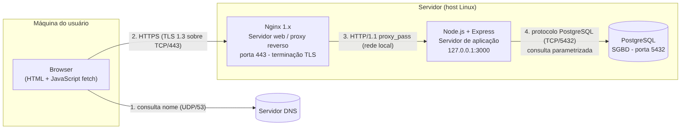
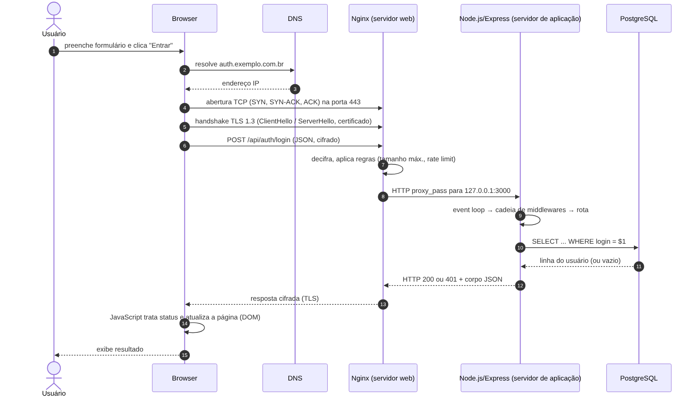
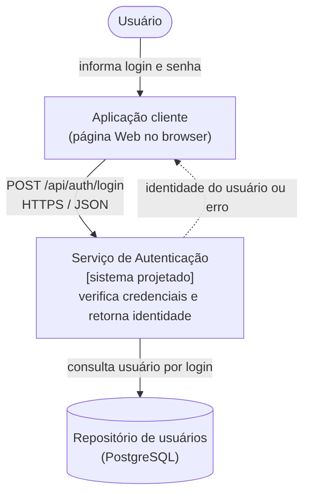
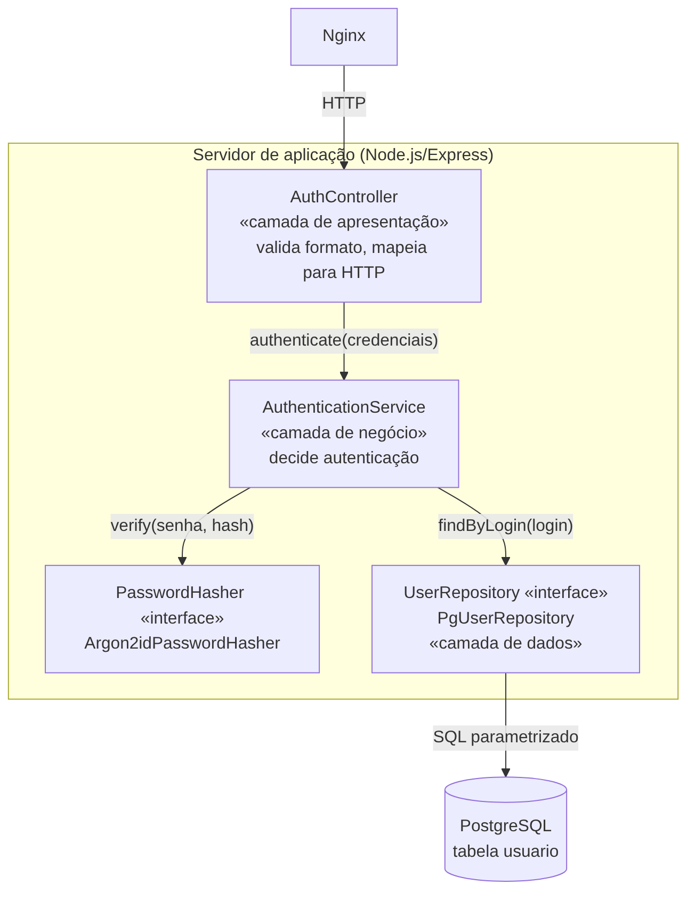
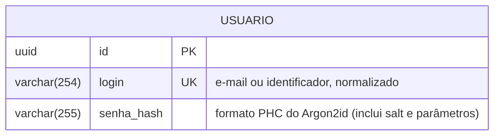
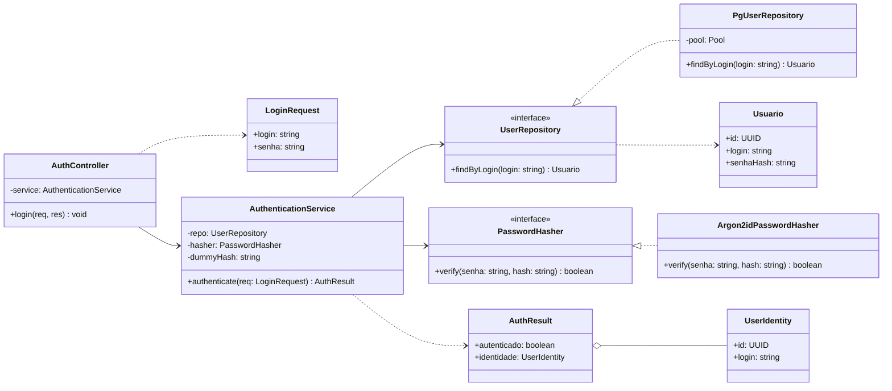
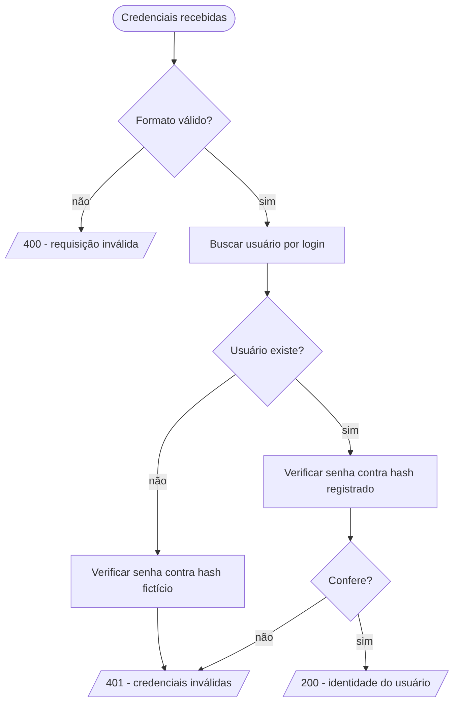
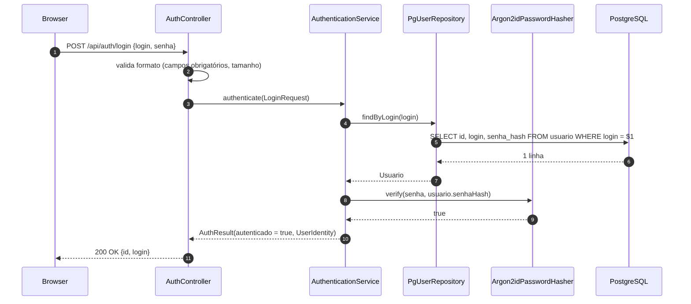
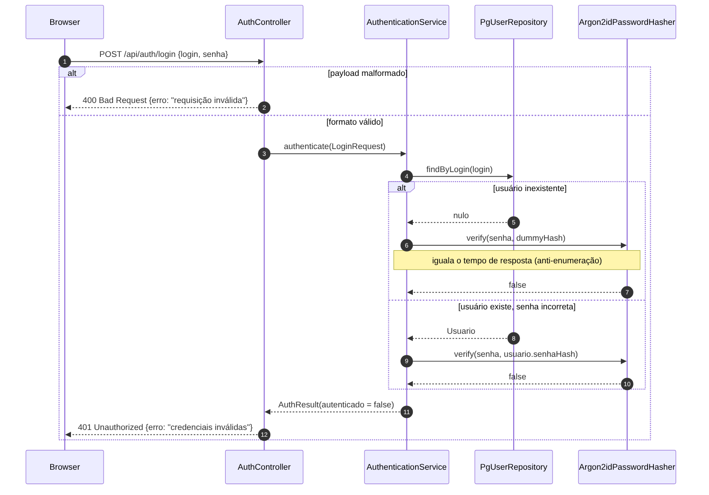

> **ESBOÇO.** Os trechos entre colchetes são pendências da equipe. Os textos-base foram rascunhados com apoio de IA e **precisam ser reescritos, revisados e citados** conforme a regra 8 (ver Apêndice I).

# Controle de autoria e revisão {#autoria}

Tabela 1 relaciona cada item de informação ao seu autor e revisor (regra 7). A mesma pessoa não pode ser autora e revisora do mesmo item.

**Tabela 1 – Autoria e revisão dos itens de informação**

| Item | Artefato | Autor(a) | Revisor(a) |
|---|---|---|---|
| [1.1](#s1-1) | Visão geral e Figura 1 | [ ] | [ ] |
| [1.2](#s1-2) | Cliente: browser | [ ] | [ ] |
| [1.3](#s1-3) | Rede: DNS, TCP, TLS | [ ] | [ ] |
| [1.4](#s1-4) | Servidor web | [ ] | [ ] |
| [1.5](#s1-5) | Servidor de aplicação | [ ] | [ ] |
| [1.6](#s1-6) | SGBD | [ ] | [ ] |
| [1.7](#s1-7) | Ciclo da requisição e Figura 2 | [ ] | [ ] |
| [2.1](#s2-1) | Requisitos e escopo | [ ] | [ ] |
| [2.2](#s2-2) | Decisões arquiteturais | [ ] | [ ] |
| [2.3](#s2-3) | Contexto e Figura 3 | [ ] | [ ] |
| [2.4](#s2-4) | Componentes e Figura 4 | [ ] | [ ] |
| [2.5](#s2-5) | Contrato da API | [ ] | [ ] |
| [2.6](#s2-6) | Modelo de dados e Figura 5 | [ ] | [ ] |
| [2.7](#s2-7) | Desenho detalhado, Figuras 6 a 9 | [ ] | [ ] |
| [2.8](#s2-8) | Segurança e tratamento de erros | [ ] | [ ] |

# 1 Ambiente operacional da aplicação Web {#s1}

## 1.1 Visão geral e pilha adotada {#s1-1}
*Autor(a): [ ] · Revisor(a): [ ]*

A aplicação é executada por quatro softwares de apoio: o browser, no computador do usuário; o servidor DNS, que traduz nomes em endereços; o Nginx, como servidor web e proxy reverso; o Node.js com o framework Express, como servidor de aplicação; e o PostgreSQL, como sistema gerenciador de banco de dados. A Figura 1 mostra onde cada um é executado e por qual protocolo se comunicam. A mesma pilha é usada no projeto da Seção 2 ([2.4](#s2-4)).

{#fig1 width=95%}

[Justificar a escolha da pilha em um parágrafo: tecnologias amplamente documentadas; separação entre servidor web e servidor de aplicação.]

## 1.2 Cliente: browser {#s1-2}
*Autor(a): [ ] · Revisor(a): [ ]*

**Invocação:** o usuário digita a URL ou aciona um link. O browser baixa o documento HTML, constrói o DOM e executa o JavaScript da página. Ao submeter o formulário de login, o script chama `fetch()` com método `POST` e corpo JSON.

**Resultado gerado:** uma mensagem de requisição HTTP com linha de requisição, cabeçalhos (`Host`, `Content-Type: application/json`, `Origin`) e corpo. Ao receber a resposta, o browser entrega o código de status e o corpo ao script, que atualiza a página.

[Citar: RFC 9110 para a semântica HTTP; WHATWG Fetch Standard para `fetch()`.]

## 1.3 Rede: DNS, TCP e TLS {#s1-3}
*Autor(a): [ ] · Revisor(a): [ ]*

**DNS:** o resolvedor converte o nome do host em endereço IP. **TCP:** estabelece a conexão confiável na porta 443 por meio do *three-way handshake*. **TLS 1.3:** autentica o servidor pelo certificado digital e negocia as chaves de sessão. A partir daí a requisição HTTP trafega cifrada, o que é obrigatório porque a senha viaja no corpo da mensagem.

[Citar: RFC 1034/1035 (DNS), RFC 9293 (TCP), RFC 8446 (TLS 1.3).]

## 1.4 Servidor web: Nginx {#s1-4}
*Autor(a): [ ] · Revisor(a): [ ]*

**Invocação:** processo residente, iniciado pelo sistema operacional (systemd), que escuta a porta 443. Um processo *master* lê a configuração e processos *worker* atendem conexões de forma orientada a eventos.

**Processamento e resultado:** termina o TLS, aplica limites (tamanho máximo do corpo e taxa de requisições por IP), serve arquivos estáticos (HTML, JS, CSS) diretamente e encaminha requisições `/api/` ao servidor de aplicação via `proxy_pass`, acrescentando cabeçalhos como `X-Forwarded-For`. Devolve ao browser a resposta do servidor de aplicação, cifrada.

[Citar: documentação oficial do Nginx (nginx.org/en/docs).]

## 1.5 Servidor de aplicação: Node.js/Express {#s1-5}
*Autor(a): [ ] · Revisor(a): [ ]*

**Invocação:** processo Node.js iniciado por um gerenciador de processos, escutando apenas a interface local (`127.0.0.1:3000`). Recebe HTTP do Nginx. O laço de eventos (*event loop*) despacha cada requisição para a cadeia de *middlewares* do Express (interpretação do JSON, validação) e, por fim, para o tratador da rota.

**Resultado gerado:** objeto de resposta HTTP com código de status, cabeçalhos e corpo JSON. Operações de I/O, como a consulta ao banco, são assíncronas e não bloqueiam o laço. O cálculo do Argon2id é custoso em CPU e deve rodar fora da thread principal [verificar e citar a documentação da biblioteca escolhida].

[Citar: documentação do Node.js (event loop) e do Express (middlewares, roteamento).]

## 1.6 SGBD: PostgreSQL {#s1-6}
*Autor(a): [ ] · Revisor(a): [ ]*

**Invocação:** o servidor de aplicação mantém um *pool* de conexões TCP com o PostgreSQL e envia consultas parametrizadas, nas quais o valor informado pelo usuário vai separado do texto SQL.

**Resultado gerado:** um conjunto de linhas (zero ou uma, para a busca por login), que o driver converte em objeto JavaScript.

[Citar: documentação do PostgreSQL (protocolo e consultas preparadas).]

## 1.7 Ciclo completo de uma requisição de login {#s1-7}
*Autor(a): [ ] · Revisor(a): [ ]*

A Figura 2 consolida os itens [1.2](#s1-2) a [1.6](#s1-6) em ordem temporal, desde a ação do usuário até a exibição do resultado.

{#fig2 width=100%}

[Descrever cada passo numerado da figura em um parágrafo curto, sem repetir o conteúdo de 1.2 a 1.6. Referenciar o item correspondente.]

# 2 Projeto da aplicação de autenticação {#s2}

## 2.1 Requisitos e escopo {#s2-1}
*Autor(a): [ ] · Revisor(a): [ ]*

**Tabela 2 – Requisitos funcionais (derivados do Apêndice A do enunciado)**

| Id | Requisito |
|---|---|
| RF01 | Receber credenciais compostas por login (e-mail ou identificador) e senha. |
| RF02 | Verificar a existência do usuário no repositório de dados. |
| RF03 | Comparar a senha fornecida com a credencial registrada. |
| RF04 | Decidir entre "autenticado" e "não autenticado". |
| RF05 | Em caso de sucesso, retornar a identificação do usuário. |
| RF06 | Em caso de falha, retornar erro de autenticação. |

**Tabela 3 – Restrições de projeto**

| Id | Restrição | Justificativa |
|---|---|---|
| RNF01 | Comunicação exclusivamente por HTTPS. | A senha trafega no corpo da requisição. |
| RNF02 | Senha armazenada somente como hash Argon2id com salt. | Vazamento do banco não expõe senhas [OWASP Password Storage]. |
| RNF03 | Mesma resposta e tempo equivalente para usuário inexistente e senha errada. | Impede enumeração de usuários [OWASP Authentication]. |
| RNF04 | Consultas SQL parametrizadas. | Impede injeção de SQL. |
| RNF05 | Limite de tentativas por IP no servidor web. | Reduz ataques de força bruta. |

**Fora do escopo:** cadastro, alteração e recuperação de senha, autenticação multifator, emissão de sessão ou token, e autorização. O enunciado restringe o software à verificação de credenciais. [Registrar a confirmação da docente sobre o formato do objeto de retorno.]

## 2.2 Decisões arquiteturais {#s2-2}
*Autor(a): [ ] · Revisor(a): [ ]*

**Tabela 4 – Registro de decisões arquiteturais**

| Id | Decisão | Alternativa descartada | Motivo |
|---|---|---|---|
| DA01 | Arquitetura em camadas (apresentação, negócio, dados). | Hexagonal; microsserviços. | Um único caso de uso não justifica mais indireção. |
| DA02 | API HTTP com JSON (`POST /api/auth/login`). | Formulário com renderização no servidor. | Desacopla o cliente do serviço. |
| DA03 | Interfaces `UserRepository` e `PasswordHasher`. | Acesso direto ao driver e à biblioteca de hash. | Permite trocar o SGBD ou o algoritmo sem alterar a regra de negócio. |
| DA04 | Argon2id para hash de senha. | bcrypt; SHA-256. | Recomendado pela OWASP; SHA-256 é rápido demais para senhas. |
| DA05 | Retorno restrito a `{id, login}`. | Retornar o registro completo. | Nunca expor o hash; essencialidade. |

## 2.3 Visão de contexto {#s2-3}
*Autor(a): [ ] · Revisor(a): [ ]*

{#fig3 width=60%}

[Um parágrafo explicando fronteiras do sistema e atores.]

## 2.4 Componentes {#s2-4}
*Autor(a): [ ] · Revisor(a): [ ]*

{#fig4 width=60%}

**Tabela 5 – Responsabilidades dos componentes**

| Componente | Camada | Responsabilidade |
|---|---|---|
| AuthController | Apresentação | Validar formato da entrada; converter `AuthResult` em resposta HTTP. |
| AuthenticationService | Negócio | Orquestrar busca, comparação e decisão (RF02–RF04). |
| UserRepository / PgUserRepository | Dados | Buscar usuário por login com SQL parametrizado. |
| PasswordHasher / Argon2idPasswordHasher | Infraestrutura | Verificar senha contra hash em tempo constante. |

## 2.5 Contrato da API {#s2-5}
*Autor(a): [ ] · Revisor(a): [ ]*

**Requisição:** `POST /api/auth/login`, `Content-Type: application/json`

```json
{ "login": "maria@exemplo.com.br", "senha": "••••••••" }
```

**Tabela 6 – Respostas da API**

| Status | Situação | Corpo |
|---|---|---|
| 200 OK | Autenticado | `{ "id": "3f2c…", "login": "maria@exemplo.com.br" }` |
| 400 Bad Request | Campos ausentes ou acima do tamanho máximo | `{ "erro": "requisição inválida" }` |
| 401 Unauthorized | Usuário inexistente ou senha incorreta | `{ "erro": "credenciais inválidas" }` |
| 429 Too Many Requests | Limite de tentativas excedido (Nginx) | `{ "erro": "muitas tentativas" }` |

## 2.6 Modelo de dados {#s2-6}
*Autor(a): [ ] · Revisor(a): [ ]*

{#fig5 width=55%}

O campo `login` é único e armazenado normalizado (minúsculas, sem espaços nas extremidades). O campo `senha_hash` guarda a cadeia no formato PHC, que já contém o salt e os parâmetros do Argon2id.

## 2.7 Desenho detalhado {#s2-7}
*Autor(a): [ ] · Revisor(a): [ ]*

{#fig6 width=100%}

{#fig7 width=55%}

{#fig8 width=100%}

{#fig9 width=100%}

[Explicar cada figura em um parágrafo, referenciando RF e RNF atendidos.]

## 2.8 Segurança e tratamento de erros {#s2-8}
*Autor(a): [ ] · Revisor(a): [ ]*

**Tabela 7 – Ameaças e mitigações**

| Ameaça | Mitigação no projeto | Onde |
|---|---|---|
| Interceptação da senha | TLS 1.3 | [1.3](#s1-3), RNF01 |
| Vazamento do banco | Argon2id com salt | [2.6](#s2-6), RNF02 |
| Enumeração de usuários | Mensagem única e hash fictício | Figura 9, RNF03 |
| Injeção de SQL | Consulta parametrizada | [1.6](#s1-6), RNF04 |
| Força bruta | Limite de taxa no Nginx | [1.4](#s1-4), RNF05 |
| Vazamento por log | Nunca registrar a senha nem o hash | [2.4](#s2-4) |

# Referências {#refs}

[Conferir cada referência antes de usar. Só manter as efetivamente citadas no texto.]

- FIELDING, R.; NOTTINGHAM, M.; RESCHKE, J. **RFC 9110: HTTP Semantics**. IETF, 2022.
- RESCORLA, E. **RFC 8446: The Transport Layer Security (TLS) Protocol Version 1.3**. IETF, 2018.
- EDDY, W. **RFC 9293: Transmission Control Protocol (TCP)**. IETF, 2022.
- BIRYUKOV, A.; DINU, D.; KHOVRATOVICH, D.; JOSEFSSON, S. **RFC 9106: Argon2 Memory-Hard Function for Password Hashing and Proof-of-Work Applications**. IETF, 2021.
- OWASP. **Authentication Cheat Sheet**. Disponível em: cheatsheetseries.owasp.org. Acesso em: [data].
- OWASP. **Password Storage Cheat Sheet**. Disponível em: cheatsheetseries.owasp.org. Acesso em: [data].
- NIST. **SP 800-63B: Digital Identity Guidelines – Authentication and Lifecycle Management**. [conferir revisão vigente].
- ISO/IEC/IEEE. **42010: Systems and software engineering – Architecture description**. [conferir edição].
- ISO/IEC/IEEE. **12207:2026 – Systems and software engineering – Software life cycle processes**. 2026.
- ANTHROPIC. **Claude**. Assistente de IA. Disponível em: claude.ai. Acesso em: 5 nov. 2026. Questão: Apêndice I, Seção I.1.

# Apêndice I – Prompts submetidos à IA {#ap1}

**I.1** [Transcrever literalmente os prompts usados, inclusive o envio do enunciado e o pedido "pode montar os artefatos e um esboço do documento".]

# Apêndice II – Registros de comunicação da equipe {#ap2}

[Atas de reunião, capturas do Discord e link do quadro Kanban no GitHub, em ordem cronológica.]
