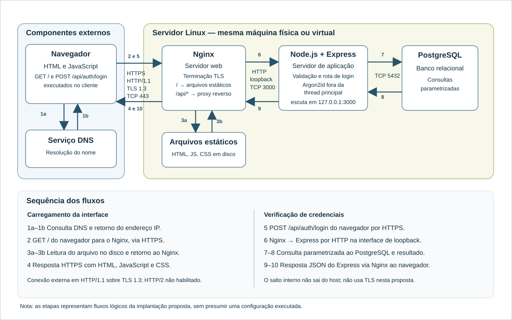

# 1.1 Visão geral e pilha adotada

Autor(a): Grazieli · Revisor(a): André

A pilha tecnológica adotada é composta por **Nginx**, como servidor web e proxy reverso; **Node.js com Express**, como servidor de aplicação; e **PostgreSQL**, como sistema gerenciador de banco de dados. O ambiente operacional também envolve o **navegador**, que executa HTML e JavaScript no computador do usuário, e o **serviço DNS**, que resolve o nome do servidor. Esses dois componentes externos não integram a pilha de execução no servidor. A Figura 1 representa a implantação proposta em um host Linux e as comunicações entre os componentes. A mesma pilha é usada no projeto da Seção 2, cujos componentes internos são detalhados no item 2.4.

Figura 1 – Implantação proposta do ambiente operacional da aplicação web. Fonte: elaborado pelos autores, com base na documentação técnica citada neste item.

A conexão externa, entre o navegador e o Nginx, usa HTTP/1.1 sobre TLS 1.3, na porta 443 (FIELDING; NOTTINGHAM; RESCHKE, 2022). O HTTP/2 não é habilitado: no Nginx, a diretiva `http2` tem valor padrão `off`, e a negociação de protocolo na conexão TLS resulta em HTTP/1.1 (NGINX, [20--]). O encaminhamento do Nginx ao Express ocorre por HTTP na interface de loopback do mesmo host e não usa TLS, como estabelece o RNF01 do item 2.1.

## Justificativa da escolha

O primeiro critério para a escolha é a **disponibilidade de documentação técnica**. Nginx, Node.js, Express e PostgreSQL oferecem documentação oficial pública sobre configuração, processamento de requisições, roteamento e acesso a dados (NGINX, [20--]; NODE.JS, [20--]; EXPRESS, [20--]; POSTGRESQL GLOBAL DEVELOPMENT GROUP, [20--]). Essa disponibilidade facilita a consulta e a manutenção do ambiente, sem implicar uma alegação de desempenho superior ou de maior adoção de mercado.

O segundo critério é a **separação de responsabilidades**. O Nginx atende as conexões externas, entrega os arquivos estáticos e encaminha as chamadas `/api/*` ao servidor de aplicação; o Express organiza o tratamento das requisições, enquanto o PostgreSQL mantém os dados (NGINX, [20--]; EXPRESS, [20--]; POSTGRESQL GLOBAL DEVELOPMENT GROUP, [20--]). Essa divisão torna explícito o papel de cada componente e favorece a manutenção. **Não representa escalabilidade independente nesta implantação**, porque Nginx e Node.js compartilham os recursos do mesmo host. As decisões que decorrem dessa divisão estão registradas no item 2.2.

Como contraponto, o processamento de operações intensivas em CPU pode prejudicar a capacidade de resposta do Node.js quando ocupa o laço de eventos principal (NODE.JS, [20--]). Na arquitetura proposta, a verificação de senhas com **Argon2id ocorre fora da thread principal**, em operação assíncrona, com biblioteca e parâmetros descritos no item 1.5. O cálculo continua consumindo CPU e memória, de modo que a concorrência de autenticações permanece limitada pelos recursos disponíveis. O limite de taxa do RNF05 (item 2.1) e a análise de ameaças do item 2.8 tratam esse risco. Essa limitação da pilha não constitui uma medição de desempenho da aplicação.

## Uso de IA

Ferramenta: Claude Code (Anthropic). Disponível em: claude.ai/code. Data: 17/11/2026. Usada na revisão do item, para aplicar as sub-issues #27 e #29.

Prompt: "Resolva as três sub-issues do item 1.1: a versão do HTTP na conexão externa, a escolha da Figura 1 e os ajustes de redação apontados na revisão."
