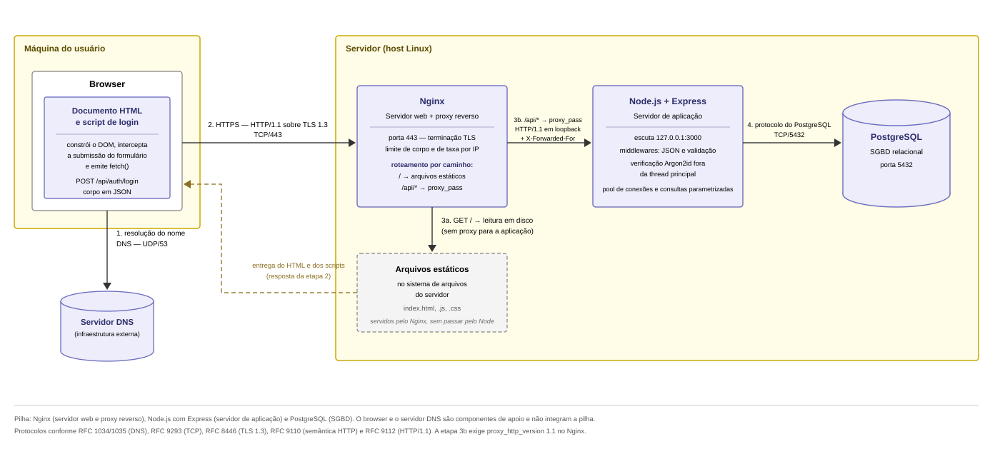

# 1.1 Visão geral e pilha adotada

Autor(a): Grazieli · Revisor(a): André

A aplicação segue uma pilha composta por três tecnologias: o Node.js com o
framework Express, como servidor de aplicação, e o PostgreSQL, como sistema
gerenciador de banco de dados, tendo como cliente um documento HTML com script
de login executado no browser. A essa pilha acrescenta-se o Nginx, atuando como
servidor web — responsável pela entrega dos arquivos estáticos e pela terminação
TLS — e como proxy reverso para o servidor de aplicação. A resolução do nome de
domínio é feita por DNS, serviço externo à aplicação. A Figura 1 mostra onde cada
componente é executado e por quais protocolos se comunicam. A mesma pilha é usada
no projeto da Seção 2 (2.4).

Figura 1 – Diagrama de implantação do ambiente operacional. Fonte: elaborado pelos autores.

## Justificativa da escolha

A escolha da pilha fundamenta-se, em primeiro lugar, na maturidade da documentação
e na adoção consolidada das tecnologias envolvidas. Nginx, Node.js, Express e
PostgreSQL possuem documentação oficial de referência e ampla base de usuários, o
que reduz o risco de interrupção do desenvolvimento por indisponibilidade de
informação técnica — fator relevante em um projeto com prazo definido. O PayPal
registrou, ao substituir sua plataforma Java por Node.js com Express, redução de
33% no volume de código, o dobro de requisições atendidas por segundo e tempo de
resposta 35% menor em aplicações de funcionalidade equivalente (HARRELL, 2013).
Pelo mesmo princípio de economia que orienta DA01, o cliente foi mantido em HTML e
JavaScript, sem framework de interface: o escopo definido em 2.1 exclui emissão de
sessão, autorização e navegação autenticada, de modo que não há estado de cliente
que justifique a indireção adicional.

O segundo critério é a separação entre servidor web e servidor de aplicação. O
Nginx assume a terminação TLS, a entrega dos arquivos estáticos, a limitação do
tamanho do corpo e da taxa de requisições por IP (RNF05), enquanto o Node.js,
escutando apenas a interface local, dedica-se à validação das credenciais e ao
acesso ao banco de dados. A divisão isola responsabilidades operacionais e de
segurança em processos distintos, permite escalar cada camada de forma
independente conforme seu próprio perfil de carga e mantém cliente e API sob a
mesma origem, dispensando a configuração de CORS.

Reconhece-se como limitação o modelo de execução em thread única do Node.js, no
qual operações intensivas em processamento bloqueiam o atendimento das demais
requisições. A restrição é pertinente a este projeto, cujo cálculo do Argon2id é
deliberadamente custoso em CPU e memória, e por isso executado fora da thread
principal, conforme descrito em 1.5.
