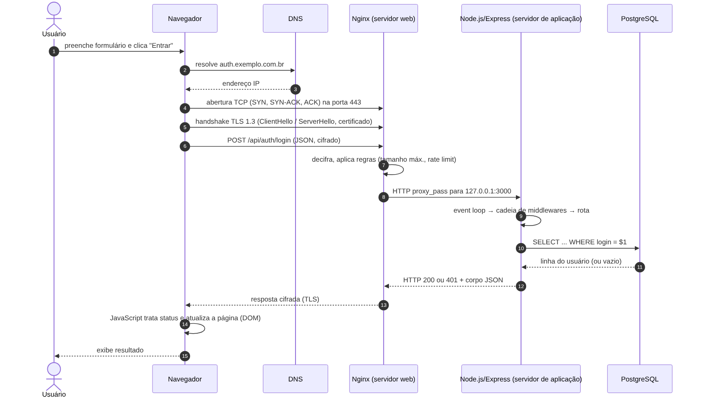

# 1.7 Ciclo completo de uma requisição de login

Autor(a): Lucas · Revisor(a): Lucas

A Figura 2 reúne, em ordem temporal, o que os itens 1.2 a 1.6 descrevem separadamente: o percurso de uma tentativa de login desde o clique do usuário até a exibição do resultado. Este item não repete o funcionamento de cada software; ele indica em que passo cada um atua e remete ao item que o detalha. Os números entre parênteses correspondem aos passos da figura.

Figura 2 – Diagrama de sequência do processamento de uma requisição Web. Fonte: elaborado pelos autores.

## Do navegador ao servidor web (passos 1 a 6)

O ciclo começa quando o usuário preenche o formulário e aciona "Entrar" (1). Antes de enviar qualquer dado, o navegador precisa do endereço IP do servidor: ele consulta o DNS (2) e recebe o endereço (3), como descrito no item 1.3. Com o endereço, abre a conexão TCP com a porta 443 (4) e, sobre ela, executa o handshake TLS 1.3, no qual o servidor se autentica pelo certificado (5), também no item 1.3. Só então o browser envia a requisição `POST /api/auth/login` em HTTP/1.1, com as credenciais no corpo JSON, já cifrada (6). A montagem dessa requisição pelo JavaScript da página é o assunto do item 1.2.

## No servidor web (passos 7 e 8)

O Nginx encerra o TLS e aplica as regras de borda ao endpoint de login: tamanho máximo do corpo e limite de requisições por IP (7). Se uma delas for violada, a requisição termina ali. O próprio Nginx responde 413, quando o corpo passa do limite, ou 429, quando o IP passa da taxa, e a requisição não chega ao servidor de aplicação. Caso contrário, o Nginx a encaminha por `proxy_pass` ao Node.js, que escuta só na interface local, na porta 3000 (8). O item 1.4 traz essas regras e a configuração.

## No servidor de aplicação e no SGBD (passos 9 a 12)

No Node.js, a requisição chega ao tratador da rota de login (9). O caminho dela dentro do Express é o assunto do item 1.5. O tratador busca o usuário no PostgreSQL com uma consulta parametrizada, usando uma conexão do pool (10), e recebe a linha correspondente, ou nenhuma linha se o login não existir (11). O item 1.6 descreve essa consulta e o retorno ao driver. Entre os passos 11 e 12, o servidor de aplicação compara a senha informada com o hash armazenado e decide entre autenticado e não autenticado; essa decisão e a verificação com Argon2id são detalhadas no item 2.7. O resultado volta ao Nginx como resposta HTTP (12): 200 com a identificação do usuário, 401 quando as credenciais não conferem, ou 400 quando a requisição chega incompleta ou inválida.

## Do servidor web ao usuário (passos 13 a 15)

O Nginx devolve a resposta ao navegador pela mesma conexão cifrada (13). O JavaScript da página lê o código de status e o corpo e atualiza o DOM (14), como descrito no item 1.2. O usuário vê o resultado: o acesso liberado ou a mensagem de erro correspondente ao código recebido (15).

## Síntese

Tabela 2 – Correspondência entre os passos da Figura 2 e os itens da Seção 1

| Passos | Software | Item que detalha |
|---|---|---|
| 1, 6, 14, 15 | Navegador | 1.2 |
| 2 a 5 | DNS, TCP e TLS | 1.3 |
| 7, 8, 13 | Nginx | 1.4 |
| 9, 12 | Node.js com Express | 1.5 |
| 10, 11 | PostgreSQL | 1.6 |

Fonte: elaborado pelos autores.

## Uso de IA

Ferramenta: Claude Code (Anthropic). Disponível em: claude.ai/code. Data: 17/11/2026.

Prompt: "Vamos começar pelos itens sob minha responsabilidade. Antes, levante o que falta: o que está pendente entre os itens já iniciados e o que ainda não foi iniciado."

Prompt da revisão: "Vamos concluir o item 1.7 (PR #34)."

Uso: texto redigido pela ferramenta a partir do esboço do documento (item 1.7) e da Figura 2, e ajustado depois aos itens 1.2, 1.3, 1.4 e 1.6 já mesclados, para revisão do autor.
