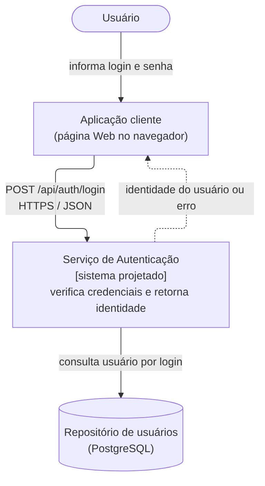

# 2.3 Visão de contexto

Autor(a): André · Revisor(a): Lucas

Este item estabelece a fronteira do sistema: o que pertence à solução projetada, o que está fora dela e quem interage com ela. A visão de contexto é a primeira das visões de projeto e condiciona as seguintes: os componentes descritos em 2.4 existem dentro desta fronteira, e o contrato da API em 2.5 descreve como ela é atravessada.

A fronteira aqui definida corresponde ao escopo declarado em 2.1. Nada do que consta da lista "fora do escopo" daquele item aparece dentro da caixa do sistema.

## O que está dentro da fronteira

O sistema é o **Serviço de Autenticação** como implantado, e compreende dois elementos:

- O **servidor web**, que recebe as conexões externas, termina o TLS exigido pelo RNF01 e aplica os limites de taxa e de tamanho de corpo exigidos pelo RNF05 e pelo RNF06.
- O **servidor de aplicação**, que valida a requisição, executa a verificação das credenciais e produz a resposta, atendendo RF01 a RF06 e RFD01 a RFD03.

O servidor web integra o sistema porque duas restrições de projeto do item 2.1 lhe são atribuídas. Uma restrição aplicada por um elemento externo não seria restrição do sistema, e sim premissa sobre o ambiente, como ocorre com o certificado digital (P03).

A estrutura interna desses dois elementos não é objeto deste item. Os componentes da aplicação são descritos em 2.4.

## O que está fora da fronteira

**Usuário.** Pessoa que informa login e senha. Não interage diretamente com o sistema: faz isso por meio da aplicação cliente.

**Aplicação cliente.** No ambiente previsto, a página HTML com JavaScript descrita em 1.1 e registrada na DA06. É quem submete as credenciais e recebe o resultado. Pela DA02, qualquer cliente capaz de emitir uma requisição HTTP ocupa esse papel: o sistema não pressupõe um cliente específico.

A aplicação cliente tem posição dupla, e isso precisa ficar explícito para não gerar leitura equivocada da Figura 3. Ela é **servida pelo** servidor web, que entrega os arquivos estáticos, e é também **consumidora do** serviço, quando submete as credenciais. A Figura 3 representa apenas o segundo trajeto, o de consumo do serviço. A entrega dos arquivos estáticos pertence ao ambiente operacional e consta da Figura 1, no item 1.1.

**Repositório de usuários.** Sistema externo consultado para obter o registro correspondente ao login, conforme RF02. É externo por decisão de escopo, e não por acaso: o software projetado apenas lê. O cadastro, a alteração e a recuperação de senha estão fora do escopo (2.1), de modo que o conteúdo e o formato do repositório são premissa, não responsabilidade. As premissas P01 e P02 registram o que o sistema assume a respeito dele.

**Serviço de resolução de nomes.** Participa do ambiente operacional, descrito em 1.3, mas não é interlocutor do serviço de autenticação. Não aparece como ator nesta visão.

## Travessias da fronteira

A fronteira é atravessada em três pontos, e apenas nestes três:

Tabela 6 – Travessias da fronteira do sistema

| Travessia | Sentido | Conteúdo | Especificado em |
|---|---|---|---|
| Aplicação cliente para o sistema | Entrada | Credenciais, em requisição HTTP sobre TLS | 2.5, contrato da API |
| Sistema para a aplicação cliente | Saída | Identificação do usuário, em caso de sucesso, ou erro de autenticação | 2.5, contrato da API |
| Sistema para o repositório de usuários | Saída e retorno | Consulta parametrizada por login e registro correspondente | 1.6 e 2.6 |

Fonte: elaborado pelos autores.

Não há outra entrada. O sistema não expõe rota administrativa, não recebe notificação de sistema externo e não mantém canal aberto entre requisições.

## Figura 3

Figura 3 – Diagrama de contexto do Serviço de Autenticação. Fonte: elaborado pelos autores.

A Figura 3 representa a fronteira descrita acima, com o sistema ao centro, os atores externos ao redor e as travessias identificadas. O trajeto representado é o de consumo do serviço: a submissão das credenciais, o retorno do resultado e a consulta ao repositório. A entrega dos arquivos estáticos à aplicação cliente não consta desta figura, por pertencer ao ambiente operacional, descrito no item 1.1.

## Fronteira e escopo

Três elementos recorrentes em sistemas de autenticação não aparecem nesta visão, e a ausência é deliberada.

Não há serviço de sessão nem emissor de token, em razão da leitura restrita do objeto de retorno adotada em 2.1. Não há serviço de autorização, porque a autorização responde a pergunta distinta da que este sistema responde. Não há serviço de gestão de usuários, porque toda escrita no repositório está fora do escopo.

Um diagrama de contexto que trouxesse qualquer um deles contradiria o item 2.1.

## Fontes

Este item não utiliza bibliografia externa. A fronteira decorre do escopo definido no Apêndice A do enunciado e consolidado no item 2.1, e das decisões registradas no item 2.2.

## Uso de IA

Ferramenta: Claude, assistente de IA da Anthropic.
URL: https://claude.ai
Data de uso: 17 nov. 2026.

Prompts:

1. "vamos para os próximos itens?"
2. "Terminamos o 2.1 e 2.2"
3. "É dentro" (resposta à consulta sobre a posição do servidor web na fronteira do sistema)
4. "Antes de finalizar a 2.7. Vamos fazer os ajustes nas anteriores:" (com as capturas da revisão do PR pelo revisor do item)

Na mesma sessão de conversa, anteriormente a estes prompts, haviam sido anexados o enunciado da APS, o documento de quebra de escopo e atribuição da equipe e o esboço do documento, e haviam sido elaborados os itens 2.1 e 2.2, usados como material de origem.

Uso: a ferramenta foi empregada na redação deste item a partir do escopo definido em 2.1 e das decisões registradas em 2.2.

A definição estruturante deste item partiu de decisão do autor:

- **Posição do servidor web na fronteira do sistema.** A delimitação da fronteira é a definição da qual todo o restante do item decorre, e admitia duas soluções defensáveis: tratar o servidor web como parte do sistema ou como ator externo. A ferramenta apresentou as duas com as respectivas consequências. O autor decidiu mantê-lo dentro da fronteira. A razão registrada no item é que o 2.1 atribui ao servidor web duas restrições de projeto, o RNF05 e o RNF06, e uma restrição aplicada por elemento externo não seria restrição do sistema, mas premissa sobre o ambiente. A alternativa teria deslocado essas duas restrições para fora do sistema que elas restringem e exigido revisão do 2.4.

Decorrem dessa decisão a composição da seção "O que está dentro da fronteira", a exclusão do servidor web da lista de atores externos e o número de travessias registradas.

O conteúdo foi conferido e assumido pelo autor.

**Revisão incorporada.** Em atendimento à revisão do item: a Figura 3 foi inserida com legenda e fonte; a marcação que pedia conferência da figura foi removida; o número de travessias da fronteira foi corrigido de dois para três; a tabela de travessias passou a ser numerada; e o parágrafo sobre a posição dupla da aplicação cliente passou a declarar que a Figura 3 representa apenas o trajeto de consumo do serviço.
