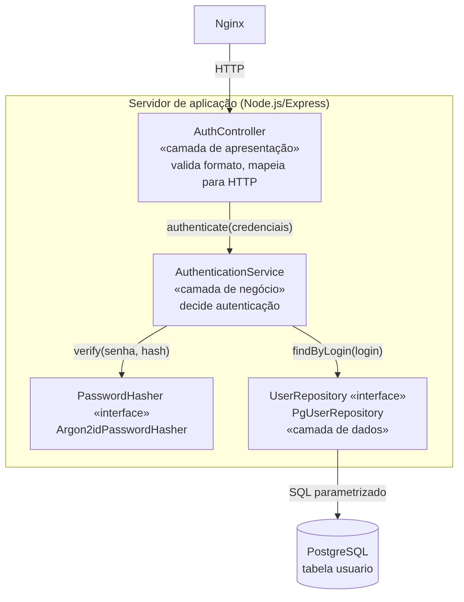

# 2.4 — Componentes

Autor(a): Kamilly · Revisor(a): Lucas

## Organização dos componentes

A arquitetura da aplicação é organizada em quatro camadas: apresentação, negócio, dados e infraestrutura. Essa divisão permite separar as responsabilidades de cada parte do sistema, facilitando a manutenção, a compreensão do funcionamento e a substituição de implementações específicas sem alterar diretamente as regras de negócio.

A organização segue a decisão arquitetural DA01, registrada no item 2.2. A aplicação utiliza HTML e JavaScript no cliente, Nginx como servidor Web e proxy reverso, Node.js com Express no servidor de aplicação e PostgreSQL como sistema gerenciador de banco de dados.

## Camada de apresentação

A camada de apresentação é responsável pela interação com o usuário e pelo recebimento das requisições relacionadas à autenticação. Ela é composta pela página HTML, pelos scripts JavaScript executados no navegador e pelo componente `AuthController`.

O HTML define a estrutura da interface, incluindo os campos necessários para a entrada das credenciais. O JavaScript captura os dados informados pelo usuário e utiliza a API Fetch para enviar uma requisição HTTP do tipo POST ao endpoint `/api/auth/login`, com o conteúdo no formato JSON.

O `AuthController` recebe a requisição encaminhada pela rota correspondente, realiza a validação do formato dos dados recebidos e direciona as informações válidas ao serviço de autenticação. Após o processamento, também é responsável por organizar e devolver a resposta HTTP ao cliente.

Em caso de autenticação bem-sucedida, a resposta contém somente a identificação do usuário, sem expor o hash da senha. Em caso de falha, o controlador retorna a resposta de erro correspondente.

Conforme a decisão DA06 do item 2.2, a interface utiliza HTML e JavaScript sem a adoção de um framework adicional.

## Camada de negócio

A camada de negócio concentra as regras relacionadas ao processo de autenticação. Seu principal componente é o serviço de autenticação, denominado `AuthenticationService`.

Esse serviço coordena as operações necessárias para verificar as credenciais informadas pelo usuário. Para acessar os dados, utiliza a interface `UserRepository`. Para verificar a senha, utiliza a interface `PasswordHasher`.

Essas interfaces permitem separar as regras de autenticação das implementações responsáveis pelo armazenamento e pela verificação das senhas. Dessa maneira, a camada de negócio não depende diretamente do PostgreSQL nem de uma biblioteca específica de hash.

O serviço também aplica a regra definida pela decisão DA08: mesmo quando o usuário não é encontrado, realiza a operação de verificação utilizando um hash fictício com os mesmos parâmetros do hash real. Essa medida reduz diferenças de tempo que poderiam permitir a identificação de contas existentes.

## Camada de dados

A camada de dados é responsável pela persistência e recuperação das informações dos usuários. Ela contém o componente `PgUserRepository`, responsável por implementar a interface `UserRepository` e realizar as operações necessárias no banco de dados PostgreSQL.

Esse componente executa consultas parametrizadas para localizar os registros de usuários, evitando a concatenação direta de dados fornecidos pelo cliente nas instruções SQL.

O repositório acessa a tabela `usuario`, que armazena o identificador, o login normalizado e o hash da senha. A estrutura dessa tabela é apresentada no item 2.6.

A utilização do repositório permite que a camada de negócio solicite informações sem precisar conhecer os detalhes de comunicação com o banco de dados.

## Camada de infraestrutura

A camada de infraestrutura reúne os componentes responsáveis pela comunicação externa e pelas implementações técnicas utilizadas pelo sistema.

O Nginx recebe as conexões HTTPS na porta 443, realiza a terminação TLS, disponibiliza os arquivos estáticos e encaminha as requisições destinadas à API para o servidor de aplicação.

O servidor Node.js com Express recebe as requisições encaminhadas pelo Nginx e disponibiliza as rotas utilizadas pela aplicação. Essas rotas direcionam as requisições ao `AuthController`, responsável pelo tratamento da entrada e da resposta HTTP.

Essa camada também contém a implementação concreta da interface `PasswordHasher`, denominada `Argon2idPasswordHasher`, responsável por utilizar o algoritmo Argon2id para verificar as senhas.

A separação entre a interface `PasswordHasher` e sua implementação concreta permite que a camada de negócio utilize a operação de verificação sem depender diretamente da biblioteca responsável pelo algoritmo.

## Comunicação entre os componentes

O processo de autenticação começa quando o usuário informa suas credenciais na interface apresentada pelo navegador.

O JavaScript envia uma requisição HTTP para o endpoint `POST /api/auth/login`. O Nginx recebe a conexão HTTPS, aplica os limites configurados e encaminha a requisição para o servidor Node.js com Express.

A rota correspondente direciona a requisição ao `AuthController`, localizado na camada de apresentação. O controlador valida o formato dos dados recebidos e encaminha as informações ao `AuthenticationService`, na camada de negócio.

O serviço de autenticação utiliza a interface `UserRepository` para localizar o usuário na camada de dados e a interface `PasswordHasher` para verificar a senha informada. As implementações concretas dessas interfaces são, respectivamente, `PgUserRepository`, que realiza o acesso ao PostgreSQL, e `Argon2idPasswordHasher`, que realiza a verificação utilizando Argon2id.

Após concluir a verificação, o serviço retorna o resultado ao `AuthController`. Em caso de sucesso, o controlador devolve uma resposta contendo somente a identificação do usuário, sem expor o registro completo ou o hash da senha. Em caso de falha, retorna a resposta correspondente ao contrato da API.

Dessa forma, cada componente possui uma responsabilidade definida, enquanto a comunicação entre as camadas permite executar o processo de autenticação de maneira organizada.

Tabela 8 – Componentes da aplicação e suas responsabilidades

| Camada | Componente | Responsabilidade |
|---|---|---|
| Apresentação | Página HTML | Estruturar a interface de autenticação e os campos de entrada. |
| Apresentação | JavaScript / Fetch | Capturar as credenciais, enviar a requisição HTTP e tratar a resposta recebida. |
| Apresentação | `AuthController` | Receber a requisição, validar o formato dos dados, acionar o serviço de autenticação e organizar a resposta HTTP. |
| Negócio | `AuthenticationService` | Coordenar o processo de autenticação e aplicar as regras de negócio. |
| Negócio | `UserRepository` | Definir a interface para localizar e recuperar informações dos usuários. |
| Negócio | `PasswordHasher` | Definir a interface para verificar a senha informada. |
| Dados | `PgUserRepository` | Implementar o acesso aos registros de usuários no PostgreSQL. |
| Dados | PostgreSQL | Armazenar os dados persistentes da tabela `usuario`. |
| Infraestrutura | Nginx | Receber conexões HTTPS, realizar terminação TLS, servir arquivos estáticos, encaminhar requisições e aplicar limites. |
| Infraestrutura | Node.js / Express | Executar o servidor de aplicação e disponibilizar as rotas HTTP. |
| Infraestrutura | `Argon2idPasswordHasher` | Implementar a verificação de senhas utilizando o algoritmo Argon2id. |

Fonte: elaborado pelos autores.

## Figura 4 – Componentes da aplicação por camada

Figura 4 – Componentes da aplicação por camada. Fonte: elaborado pelos autores.

A Figura 4 apresenta a organização dos componentes da aplicação nas quatro camadas arquiteturais e as relações de comunicação entre eles. É possível observar a separação entre os elementos responsáveis pela interação com o usuário, pela execução das regras de autenticação, pela persistência dos dados e pelos recursos de infraestrutura.

Na camada de apresentação, o `AuthController` recebe as requisições e realiza a validação do formato dos dados. Na camada de negócio, o `AuthenticationService` coordena o processo de autenticação e utiliza as interfaces `UserRepository` e `PasswordHasher`. Na camada de dados, o `PgUserRepository` implementa o acesso ao PostgreSQL. Já na infraestrutura, estão os componentes responsáveis pela comunicação HTTP, pelo Nginx e pela implementação do algoritmo Argon2id.

Essa organização demonstra como os componentes colaboram para realizar a autenticação, mantendo suas responsabilidades separadas e respeitando a arquitetura definida no item 2.2.

## Fontes

- EXPRESS. *Express 5.x – API Reference*. [20--]. Disponível em: https://expressjs.com/en/5x/api.html. Acesso em: 17 nov. 2026.
- FIELDING, R.; NOTTINGHAM, M.; RESCHKE, J. (ed.). *HTTP Semantics*. RFC 9110. [S. l.]: IETF, jun. 2022. Disponível em: https://www.rfc-editor.org/rfc/rfc9110. Acesso em: 17 nov. 2026.
- NGINX. *Beginner's Guide*. [20--]. Disponível em: https://nginx.org/en/docs/beginners_guide.html. Acesso em: 17 nov. 2026.
- NODE.JS. *Node.js Documentation*. [20--]. Disponível em: https://nodejs.org/docs/latest/api/. Acesso em: 17 nov. 2026.
- OWASP. *Password Storage Cheat Sheet*. [20--]. Disponível em: https://cheatsheetseries.owasp.org/cheatsheets/Password_Storage_Cheat_Sheet.html. Acesso em: 17 nov. 2026.
- POSTGRESQL GLOBAL DEVELOPMENT GROUP. *PostgreSQL Documentation*. [20--]. Disponível em: https://www.postgresql.org/docs/current/. Acesso em: 17 nov. 2026.

## Uso de IA

Ferramenta: ChatGPT, da OpenAI.  
URL: https://chatgpt.com  
Data de uso: 17 nov. 2026.

Prompt literal utilizado:

"Faça as alterações necessárias no item 2.4: troque PostgreSQLUserRepository por PgUserRepository, inclua o AuthController na camada de apresentação, insira a Figura 4 pelo caminho informado, acrescente a fonte abaixo da tabela e padronize as fontes."

Material fornecido como referência: item 2.2 — Decisões arquiteturais —, Figura 4 e orientações de revisão do item 2.4.
