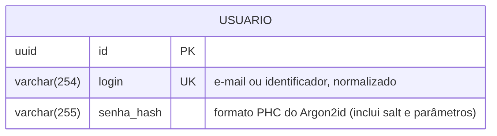

# 2.6 Modelo de dados

Autor(a): Kamilly · Revisor(a): Lucas

## Estrutura da tabela

O modelo de dados utiliza a tabela `usuario`, responsável por armazenar as informações necessárias para identificar o usuário e permitir a verificação de sua senha durante a autenticação. A estrutura segue os tipos apresentados na Figura 5.

| Campo | Tipo | Restrições e finalidade |
|---|---|---|
| `id` | `uuid` | Chave primária, gerada automaticamente por `gen_random_uuid()`. |
| `login` | `varchar(254)` | Não nulo e único. Armazena o login normalizado do usuário. |
| `senha_hash` | `varchar(255)` | Não nulo. Armazena o hash da senha, gerado com Argon2id. |

Fonte: elaborado pelos autores.

A definição da tabela em SQL é:

```sql
CREATE TABLE usuario (
    id UUID PRIMARY KEY DEFAULT gen_random_uuid(),
    login VARCHAR(254) NOT NULL UNIQUE,
    senha_hash VARCHAR(255) NOT NULL
);
```

## Regra de armazenamento do login

Conforme a premissa P02, definida no item 2.1, o repositório já mantém o login em sua forma normalizada. Assim, antes de realizar a consulta, o serviço de autenticação aplica ao valor recebido a mesma regra de normalização. Dessa maneira, a comparação é feita utilizando o mesmo padrão adotado no armazenamento.

O cadastro de usuários não faz parte do escopo deste projeto. Portanto, este item considera a premissa P02 como condição para que os dados existentes no repositório estejam armazenados de forma compatível com a consulta.

## Armazenamento da senha

O campo `senha_hash` armazena o resultado da aplicação do algoritmo Argon2id à senha do usuário. A aplicação não deve armazenar senhas em texto puro. O valor codificado do hash contém as informações necessárias para a verificação, como os parâmetros utilizados, o salt e o resultado do processamento.

Durante a autenticação, o serviço obtém o hash correspondente ao login consultado e utiliza o componente responsável pela verificação de senhas para comparar a senha recebida com o hash armazenado.

## Figura 5 – Modelo de dados



Figura 5 – Modelo de dados. Fonte: elaborado pelos autores.

A Figura 5 apresenta a estrutura da tabela `usuario`, com os campos `id`, `login` e `senha_hash`, seus respectivos tipos e as restrições aplicadas. O campo `id` identifica cada registro por meio de um UUID; o campo `login` armazena o identificador normalizado e possui restrição de unicidade; e o campo `senha_hash` guarda o hash utilizado no processo de autenticação.

## Relação com o acesso ao banco de dados

O componente `PgUserRepository` implementa o acesso à tabela `usuario` por meio do PostgreSQL. Para consultar um usuário, utiliza consultas parametrizadas, evitando a concatenação direta de valores recebidos na instrução SQL. A conexão com o banco é realizada por meio de um pool de conexões, conforme descrito no item 1.6.

A consulta utiliza o login normalizado recebido do serviço de autenticação e retorna os dados necessários para o processo, incluindo o identificador do usuário e o hash da senha. O hash é utilizado pelo componente responsável pela verificação com Argon2id, sem ser exposto na resposta enviada ao cliente.

## Fontes

- BIRYUKOV, A.; DINU, D.; KHOVRATOVICH, D.; JOSEFSSON, S. *Argon2 Memory-Hard Function for Password Hashing and Proof-of-Work Applications*. RFC 9106. [S. l.]: IETF, set. 2021. Disponível em: https://www.rfc-editor.org/rfc/rfc9106. Acesso em: 17 nov. 2026.
- OWASP. *Password Storage Cheat Sheet*. [20--]c. Disponível em: https://cheatsheetseries.owasp.org/cheatsheets/Password_Storage_Cheat_Sheet.html. Acesso em: 17 nov. 2026.
- POSTGRESQL GLOBAL DEVELOPMENT GROUP. *Constraints*. [20--]a. Disponível em: https://www.postgresql.org/docs/current/ddl-constraints.html. Acesso em: 17 nov. 2026.
- POSTGRESQL GLOBAL DEVELOPMENT GROUP. *UUID Type*. [20--]c. Disponível em: https://www.postgresql.org/docs/current/datatype-uuid.html. Acesso em: 17 nov. 2026.

## Uso de IA

Ferramenta: ChatGPT, da OpenAI.
URL: https://chatgpt.com
Data de uso: 17 nov. 2026.

Prompt literal utilizado na primeira versão:

"Lembra sobre o uqe estavamos falando? melhore o texto com base naquele texto que te pedi para ver se atendia os requisitos e se estava bom (2.4). Agora verificar se esta bom e atende os requisitoos do 2.6. nao inventa bobeira."

Na revisão, a ferramenta foi usada para ajustar o item 2.6: alinhar os tipos dos campos à Figura 5, considerar a premissa P02 do item 2.1 para a normalização do login, inserir a imagem e sua legenda, acrescentar a fonte abaixo da tabela e padronizar as seções de fontes, autoria e uso de IA.

Material fornecido como referência: documento do item 2.2 — Decisões arquiteturais — e documento de atribuições reorganizadas da APS.
