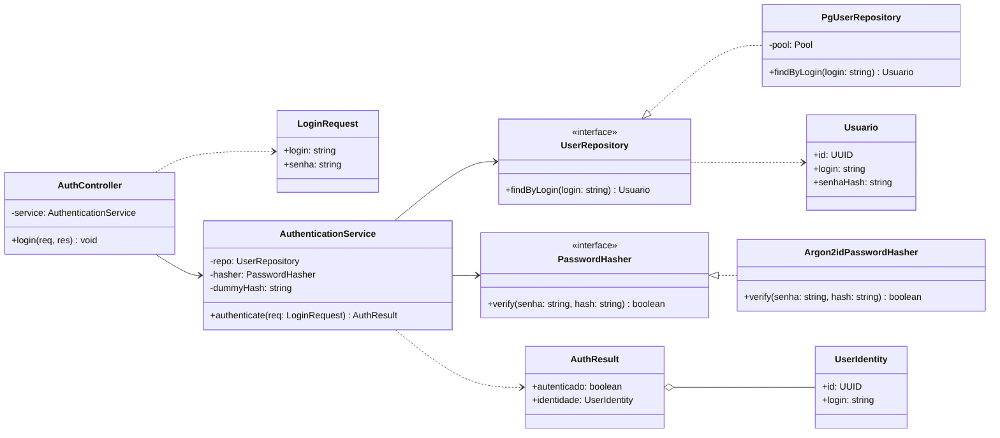
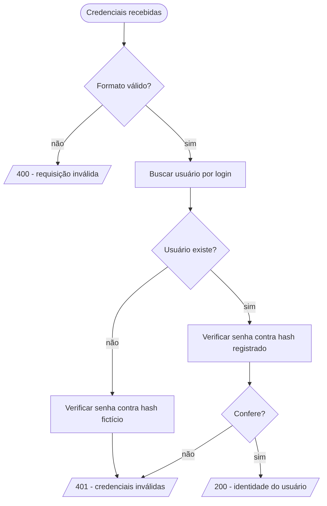
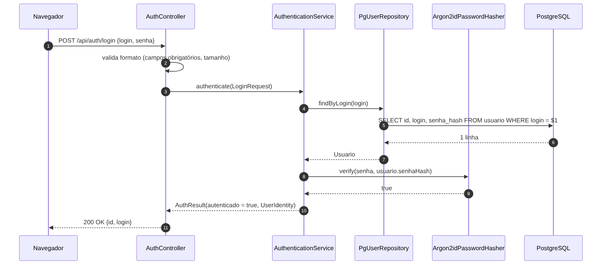
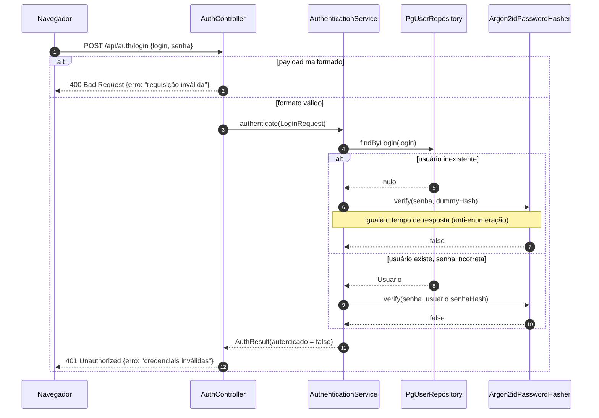

# 2.7 Desenho detalhado

Autor(a): André · Revisor(a): Lucas

Este item descreve a estrutura estática da aplicação, a lógica de decisão da autenticação e o comportamento dinâmico nos casos de sucesso e de falha, por meio das Figuras 6 a 9.

As classes aqui descritas realizam os componentes identificados em 2.4 e implementam as decisões registradas em 2.2. A lógica de decisão e as sequências correspondem aos requisitos definidos em 2.1.

## Recorte comum às figuras

Três conjuntos de situações não aparecem nas figuras deste item, e a ausência é deliberada em todos os casos.

**O servidor web não figura nas sequências.** As Figuras 8 e 9 representam o processamento interno da aplicação, a partir do ponto em que o servidor web já aceitou a requisição e a encaminhou ao servidor de aplicação. A Figura 1, no item 1.1, representa o trajeto completo, e o item 2.3 posiciona ambos dentro da fronteira do sistema. Trata-se de nível de detalhe, não de divergência entre figuras.

**As respostas 413 e 429 não constam de nenhuma figura.** Elas são produzidas pelo servidor web antes de a requisição alcançar a aplicação, conforme o RNF06, o RNF05 e a DA07.

**A indisponibilidade do repositório não é representada.** A equipe optou por limitar a Figura 7 aos desfechos definidos no Apêndice A do enunciado, que são autenticado e não autenticado, acrescidos da rejeição por formato. O RFD03 permanece descrito no item 2.1 e tratado no contrato do item 2.5, sem representação gráfica. Registra-se a opção para que a ausência não seja lida como omissão.

## Figura 6 – Diagrama de classes

Figura 6 – Diagrama de classes do serviço de autenticação. Fonte: elaborado pelos autores.

A Figura 6 apresenta dez tipos e suas relações. As camadas da DA01 não são desenhadas na figura; a atribuição de cada componente à sua camada consta do item 2.4.

`AuthController` recebe a requisição e expõe `login(req, res)`. Ele depende de `AuthenticationService` e converte a entrada em `LoginRequest`, tipo que carrega apenas `login` e `senha`, atendendo ao RF01.

`AuthenticationService` concentra a regra de negócio. Seu método `authenticate(LoginRequest)` devolve `AuthResult` e executa, em ordem, a busca do usuário (RF02), a comparação da senha (RF03) e a decisão (RF04). O serviço declara três atributos: `repo`, do tipo `UserRepository`; `hasher`, do tipo `PasswordHasher`; e `dummyHash`, uma cadeia usada quando o login não existe. A presença desse terceiro atributo na estrutura, e não apenas no fluxo, registra a DA08 como parte do projeto e não como detalhe de implementação.

As duas dependências do serviço são interfaces, e não classes concretas. `UserRepository` declara `findByLogin(login): Usuario` e é realizada por `PgUserRepository`, que mantém um `pool` de conexões. `PasswordHasher` declara `verify(senha, hash): boolean` e é realizada por `Argon2idPasswordHasher`. Essa separação é a DA03: a regra de negócio não conhece PostgreSQL nem Argon2id, e a substituição de qualquer um dos dois não a alcança. O RNF02 e o RNF04 são atendidos pelas implementações concretas, não pela camada de negócio.

Dois tipos representam o usuário, com conteúdos deliberadamente diferentes. `Usuario` é o registro recuperado do repositório e contém `id`, `login` e `senhaHash`. `UserIdentity` é o que compõe o `AuthResult` devolvido ao cliente e contém apenas `id` e `login`. O hash existe no primeiro e não existe no segundo. Essa diferença é a DA05 expressa na estrutura: o hash não deixa de ser exposto por disciplina de quem escreve a resposta, mas porque o tipo que sai do serviço não tem onde guardá-lo. O RNF07 é sustentado pela mesma separação.

A figura também evidencia a correspondência entre o nome da coluna no repositório e o nome do atributo no objeto. O diagrama usa `senhaHash` no tipo `Usuario`, enquanto a consulta exibida na Figura 8 usa `senha_hash`. São a mesma informação em convenções distintas, próprias de cada camada, e o modelo de dados do item 2.6 define a forma persistida.

## Figura 7 – Fluxo de decisão

Figura 7 – Fluxo de decisão da autenticação. Fonte: elaborado pelos autores.

A Figura 7 apresenta o caminho desde a chegada das credenciais até um de três desfechos.

A primeira decisão é o formato da requisição. Entrada malformada ou com campo ausente encerra o fluxo com 400, sem consulta ao repositório. Esse ramo atende ao RFD01 e ao RFD02, e justifica o código 400 listado no contrato do item 2.5.

A segunda decisão é a existência do usuário. O ramo negativo **não encerra o fluxo**: ele segue para uma verificação de senha antes de produzir o 401. Essa verificação ocorre contra o valor fictício declarado na Figura 6, e é a DA08. O ramo positivo recupera o registro e verifica a senha contra o hash armazenado, conforme o RF03.

A terceira decisão é a conferência da senha. O ramo positivo produz 200 com a identidade, atendendo ao RF05. O ramo negativo produz 401.

O aspecto mais relevante da figura é a convergência: os dois ramos de falha, usuário inexistente e senha incorreta, terminam no **mesmo nó de 401**. Não há saída distinta para cada caso. É o RNF03 representado graficamente, e não apenas afirmado em texto. Como ambos os caminhos passam pelo cálculo de um hash Argon2id com os mesmos parâmetros, as duas falhas também custam tempo equivalente, o que remove a diferença mensurável que permitiria enumerar contas existentes. O RF04 do item 2.1, que funde os dois casos em um único resultado, é o requisito que a convergência atende.

## Figura 8 – Sequência de autenticação bem-sucedida

Figura 8 – Sequência de autenticação bem-sucedida. Fonte: elaborado pelos autores.

A Figura 8 percorre onze passos entre a submissão das credenciais e a resposta de sucesso.

O navegador submete `POST /api/auth/login` com `login` e `senha` no corpo, conforme a DA02 e o RF01. O `AuthController` valida o formato da requisição, conferindo campos obrigatórios e tamanho, o que atende ao RFD01 e ao RFD02; essa validação ocorre antes de qualquer acesso ao repositório, de modo que entrada inválida não consome consulta.

Validada a entrada, o controlador delega a decisão ao `AuthenticationService`, que solicita o usuário ao `PgUserRepository` por meio de `findByLogin(login)`. O repositório emite ao PostgreSQL a consulta `SELECT id, login, senha_hash FROM usuario WHERE login = $1`, em que o marcador `$1` separa o valor informado pelo usuário do texto do comando, atendendo ao RNF04. O banco devolve uma linha, que o repositório converte no objeto `Usuario`.

De posse do registro, o serviço invoca `verify(senha, usuario.senhaHash)` no `Argon2idPasswordHasher`, atendendo ao RF03 e ao RNF02. A verificação retorna verdadeiro, e o serviço produz `AuthResult(autenticado = true, UserIdentity)`.

O controlador converte esse resultado em `200 OK` com corpo `{id, login}`. O corpo contém apenas os dois campos de `UserIdentity`: não há hash, nem o registro completo, nem token ou identificador de sessão. É o RF05 atendido na forma definida pela DA05 e pela delimitação do objeto de retorno do item 2.1.

## Figura 9 – Sequência de autenticação malsucedida

Figura 9 – Sequência de autenticação malsucedida. Fonte: elaborado pelos autores.

A Figura 9 reúne os três modos de falha em um único diagrama, por meio de dois blocos alternativos aninhados.

O primeiro bloco separa a requisição malformada da requisição bem formada. No ramo de requisição malformada, o controlador responde `400 Bad Request` com corpo `{erro: "requisição inválida"}`, sem acionar o serviço de autenticação. Esse ramo atende ao RFD01 e ao RFD02.

O segundo bloco, interno ao ramo de formato válido, separa os dois modos de falha de credencial.

No ramo de **usuário inexistente**, o repositório devolve nulo. O serviço não encerra o processamento: invoca `verify(senha, dummyHash)`, verificando a senha contra o valor fictício declarado na Figura 6. A figura anota esse passo com a observação de que ele iguala o tempo de resposta, com finalidade de impedir a enumeração de contas. É a DA08 representada, e é o que torna o RNF03 verificável em vez de meramente declarado.

No ramo de **usuário existente com senha incorreta**, o repositório devolve o objeto `Usuario` e o serviço invoca `verify(senha, usuario.senhaHash)`. A verificação retorna falso.

Os dois ramos convergem: ambos produzem `AuthResult(autenticado = false)` e, em seguida, `401 Unauthorized` com corpo `{erro: "credenciais inválidas"}`. O código, a mensagem e o custo de processamento são idênticos nos dois casos, porque ambos executam um cálculo Argon2id com os mesmos parâmetros. Um cliente que meça o tempo de resposta ou compare os corpos não distingue um login inexistente de uma senha errada.

Essa convergência atende ao RF04, que o Apêndice A do enunciado já define como resultado único para credenciais inválidas ou usuário inexistente, ao RF06 e ao RNF03.

Cabe registrar uma consequência operacional desse desenho, retomada na análise do item 2.8: como o cálculo do hash ocorre também no ramo de usuário inexistente, toda tentativa dirigida ao endpoint consome memória e processamento do servidor, independentemente de o login existir. O limite de taxa do RNF05 é a mitigação prevista.

## Rastreabilidade

Tabela 12 – Correspondência entre as figuras deste item e os requisitos e decisões

| Elemento | Figura | Atende |
|---|---|---|
| `LoginRequest` e validação de formato e tamanho | 6, 8, 9 | RF01, RFD01, RFD02 |
| `UserRepository`, `PgUserRepository` e consulta parametrizada | 6, 8 | RF02, RNF04 |
| `PasswordHasher`, `Argon2idPasswordHasher` e `verify` | 6, 8, 9 | RF03, RNF02 |
| Atributo `dummyHash` e ramo de usuário inexistente | 6, 7, 9 | RNF03, DA08 |
| Convergência dos dois ramos de falha no 401 | 7, 9 | RF04, RF06, RNF03 |
| `UserIdentity` sem campo de hash e resposta `200 OK {id, login}` | 6, 8 | RF05, RNF07, DA05 |
| Separação em quatro camadas (não desenhada; atribuição em 2.4) | 6 | DA01 |
| Uso de interfaces em vez de classes concretas | 6 | DA03 |
| `POST /api/auth/login` com corpo JSON | 8, 9 | RF01, DA02 |
| Ramo de requisição malformada com 400 | 7, 9 | RFD01, RFD02 |

Fonte: elaborado pelos autores.

## Fontes

Este item não utiliza bibliografia externa. As figuras são produto da equipe, e os requisitos e decisões referenciados estão nos itens 2.1 e 2.2, com as respectivas fontes.

## Uso de IA

Ferramenta: Claude, assistente de IA da Anthropic.
URL: https://claude.ai
Data de uso: 17 nov. 2026.

Prompts literais submetidos para a elaboração deste item:

1. "Vamos voltar para o 2.7"
2. Em resposta a três perguntas de múltipla escolha apresentadas pela ferramenta, o autor decidiu: dividir o item em 2.7a e 2.7b; manter a Figura 7 sem o caminho de indisponibilidade do repositório; e não manifestar preferência quanto à representação do hash fictício na Figura 9.
3. Envio das Figuras 6, 7, 8 e 9 do repositório, sem texto acompanhante.
4. "Antes de finalizar a 2.7. Vamos fazer os ajustes nas anteriores:" (com as capturas da revisão dos itens anteriores)
5. "Tem que colocar o link das figuras."
6. "Vamos reunir o 2.7 em um arquivo, por favor"

Na mesma sessão de conversa, anteriormente a estes prompts, haviam sido anexados o enunciado da APS, o documento de quebra de escopo e atribuição da equipe e o esboço do documento, e haviam sido elaborados os itens 2.1, 2.2 e 2.3, usados como material de origem.

Uso: a ferramenta foi empregada na redação do texto explicativo a partir das figuras já existentes no repositório, produzidas pela equipe, e dos requisitos e decisões definidos em 2.1 e 2.2. As figuras não foram criadas nem alteradas.

As seguintes definições partiram de decisão do autor:

- **Formato do item.** A WBS faculta dividir o 2.7 em 2.7a e 2.7b. O autor decidiu inicialmente dividir e, em seguida, reuniu o item em arquivo único, mantendo a convenção de um arquivo por item da WBS adotada no repositório.
- **Recorte da Figura 7.** O autor decidiu que a figura não representaria o caminho de indisponibilidade do repositório, limitando-a aos desfechos do Apêndice A. A seção de recorte registra a opção para que a ausência conste como escolha, e não como lacuna.
- **Tratamento da ausência do servidor web nas sequências.** A ferramenta identificou que as Figuras 8 e 9 não representam o servidor web, embora a Figura 1 e o item 2.3 o incluam, e apresentou as alternativas de declarar o recorte ou deixá-lo implícito. O autor decidiu declará-lo, de modo que a ausência conste como escolha de nível de detalhe e não como divergência entre figuras.

O conteúdo foi conferido e assumido pelo autor.
