# 1.5 — Diagrama de classes de dados, sem operações

**Escopo:** schema `rh` de `rh_db`, gerado do catálogo do PostgreSQL 17 depois de aplicar os scripts 001 a 005. Cada tabela é uma classe. Só atributos, sem operações. As associações vêm das chaves estrangeiras.

**Fonte versionada:** `db/docs/1.5-diagrama-classes.mmd`. A imagem é o próprio bloco Mermaid abaixo, renderizado pelo GitHub. Para regenerar: rodar o gerador e substituir este arquivo.

**Normas de referência:** ISO/IEC 42010 (descrição de arquitetura, viewpoint de dados) e ISO/IEC 11179 (metadados de dados).

**Limitação:** o diagrama mostra o modelo físico (chaves surrogadas, tabelas de vínculo N:N e tabelas de regra). Não mostra a especialização GESTOR/RH como herança, porque o SQL não tem herança entre tabelas. Ela aparece como chave estrangeira para `usuario`.

```mermaid
classDiagram
  direction LR
  class acao_acompanhamento {
    bigint cod_acao PK
    text matricula_colaborador
    bigint cod_alerta
    bigint cod_meta
    text matricula_gestor
    text matricula_rh
    text tipo
    text descricao
    timestamp_with_time_zone data_registro
    timestamp_with_time_zone data_revisao
  }
  class afastamento {
    text matricula PK
    date data_inicio PK
    text tipo
    date data_fim
  }
  class agregado_semanal {
    text cod_departamento PK
    smallint ano PK
    smallint semana PK
    numeric_3_2 humor_medio
    numeric_5_2 perc_carga_pesada
    numeric_5_2 progresso_medio
    integer respostas
    integer elegiveis
    numeric_6_5 participacao
    integer alertas_abertos
    boolean recalculo_pendente
    timestamp_with_time_zone data_calculo
  }
  class alerta {
    bigint cod_alerta PK
    text matricula_colaborador
    text tipo
    bigint cod_meta_envolvida
    text janela_ref
    text descricao
    text regra_disparada
    jsonb valores_geradores
    jsonb limiar_aplicado
    timestamp_with_time_zone data_geracao
    timestamp_with_time_zone data_encerramento
  }
  class alerta_checkin {
    bigint cod_alerta PK
    bigint cod_checkin PK
  }
  class alerta_meta {
    bigint cod_alerta PK
    bigint cod_meta PK
  }
  class alteracao_parametro {
    text cod_parametro PK
    timestamp_with_time_zone data_hora PK
    text matricula_rh
    text valor_anterior
    text valor_novo
  }
  class atribuicao_perfil {
    bigint cod_atribuicao PK
    text matricula
    smallint cod_perfil
    text matricula_autor
    date data_inicio
    date data_fim
  }
  class cargo {
    text cod_cargo PK
    text nome
    text descricao
    text id_externo
  }
  class checkin {
    bigint cod_checkin PK
    text matricula
    text coorte_departamento
    smallint ano
    smallint semana
    smallint humor
    text carga
    text comentario
    timestamp_with_time_zone data_envio
    timestamp_with_time_zone data_alteracao
    timestamp_with_time_zone data_reabertura
    timestamp_with_time_zone prazo_reabertura
    boolean anonimizado
  }
  class cobertura {
    text matricula_afastado PK
    date data_inicio_afastamento PK
    text cod_departamento PK
    date data_inicio PK
    date data_fim
    text matricula_substituto
  }
  class credencial {
    text matricula PK
    text hash_senha
    text algoritmo
    timestamp_with_time_zone trocada_em
  }
  class departamento {
    text cod_departamento PK
    text sigla
    text nome
    text situacao
    text superior_cod
    text id_externo
  }
  class designacao {
    bigint cod_designacao PK
    text matricula_gestor
    text matricula_beneficiario
    text matricula_rh
    text finalidade
    date data_inicio
    date data_fim
  }
  class destinatario_alerta {
    bigint cod_destinatario PK
    bigint cod_alerta
    text matricula
    text papel
    text estado
    timestamp_with_time_zone data_inicio
    timestamp_with_time_zone data_fim
  }
  class execucao_agendador {
    bigint cod_execucao PK
    text tarefa
    timestamp_with_time_zone iniciada_em
    timestamp_with_time_zone terminada_em
    text situacao
  }
  class gerencia {
    text cod_departamento PK
    date data_inicio PK
    date data_fim
    text matricula_gestor
  }
  class gestor {
    text matricula PK
  }
  class log_acesso {
    bigint cod_evento PK
    timestamp_with_time_zone data_hora
    text matricula_ator
    text matricula_titular
    text perfil
    text recurso
    text acao
    text resultado
  }
  class lotacao {
    text matricula PK
    date data_inicio PK
    date data_fim
    text cod_departamento
    text cod_cargo
    text motivo
  }
  class meta {
    bigint cod_meta PK
    text matricula_responsavel
    text matricula_cadastrante
    text titulo
    text descricao
    text indicador
    numeric valor_alvo
    text unidade_medida
    timestamp_with_time_zone data_criacao
    date data_inicio
    date prazo
    date data_conclusao
    text situacao
  }
  class notificacao {
    bigint cod_notificacao PK
    text matricula
    text tipo
    text canal
    text mensagem
    text semana_ref
    timestamp_with_time_zone horario_programado
    bigint cod_alerta
    bigint cod_acao
    timestamp_with_time_zone data_envio
    timestamp_with_time_zone data_leitura
    text situacao
  }
  class parametro_sistema {
    text cod_parametro PK
    text descricao
    text valor
    text unidade
  }
  class perfil {
    smallint cod_perfil PK
    text nome
  }
  class progresso_meta {
    bigint cod_checkin PK
    bigint cod_meta PK
    numeric_5_2 perc_informado
    numeric_5_2 perc_validado
    text aval_qualitativa
    text comentario_gestor
    text matricula_validador
    timestamp_with_time_zone data_validacao
  }
  class rh {
    text matricula PK
  }
  class sessao {
    uuid sessao_id PK
    text segredo_hash
    text matricula
    timestamp_with_time_zone criada_em
    timestamp_with_time_zone ultima_atividade
    timestamp_with_time_zone expira_em
    timestamp_with_time_zone revogada_em
    text motivo_revogacao
  }
  class usuario {
    text matricula PK
    text nome
    text cpf
    date data_nascimento
    text email
    text_arr telefones
    text logradouro
    text numero
    text cidade
    character_2 uf
    character_8 cep
    date data_admissao
    date data_desligamento
    text tipo_contrato
    text id_externo
  }
  acao_acompanhamento "0..N" --> "1" alerta : cod_alerta
  acao_acompanhamento "0..N" --> "1" gestor : matricula_gestor
  acao_acompanhamento "0..N" --> "1" meta : cod_meta
  acao_acompanhamento "0..N" --> "1" rh : matricula_rh
  acao_acompanhamento "0..N" --> "1" usuario : matricula_colaborador
  afastamento "0..N" --> "1" usuario : matricula
  agregado_semanal "0..N" --> "1" departamento : cod_departamento
  alerta "0..N" --> "1" meta : cod_meta_envolvida
  alerta "0..N" --> "1" usuario : matricula_colaborador
  alerta_checkin "0..N" --> "1" alerta : cod_alerta
  alerta_checkin "0..N" --> "1" checkin : cod_checkin
  alerta_meta "0..N" --> "1" alerta : cod_alerta
  alerta_meta "0..N" --> "1" meta : cod_meta
  alteracao_parametro "0..N" --> "1" parametro_sistema : cod_parametro
  alteracao_parametro "0..N" --> "1" rh : matricula_rh
  atribuicao_perfil "0..N" --> "1" perfil : cod_perfil
  atribuicao_perfil "0..N" --> "1" usuario : matricula_autor
  atribuicao_perfil "0..N" --> "1" usuario : matricula
  checkin "0..N" --> "1" departamento : coorte_departamento
  checkin "0..N" --> "1" usuario : matricula
  cobertura "0..N" --> "1" afastamento : matricula_afastado, data_inicio_afastamento
  cobertura "0..N" --> "1" departamento : cod_departamento
  cobertura "0..N" --> "1" gestor : matricula_afastado
  cobertura "0..N" --> "1" gestor : matricula_substituto
  credencial "0..N" --> "1" usuario : matricula
  departamento "0..N" --> "1" departamento : superior_cod
  designacao "0..N" --> "1" gestor : matricula_gestor
  designacao "0..N" --> "1" rh : matricula_rh
  designacao "0..N" --> "1" usuario : matricula_beneficiario
  destinatario_alerta "0..N" --> "1" alerta : cod_alerta
  destinatario_alerta "0..N" --> "1" usuario : matricula
  gerencia "0..N" --> "1" departamento : cod_departamento
  gerencia "0..N" --> "1" gestor : matricula_gestor
  gestor "0..N" --> "1" usuario : matricula
  log_acesso "0..N" --> "1" usuario : matricula_ator
  log_acesso "0..N" --> "1" usuario : matricula_titular
  lotacao "0..N" --> "1" cargo : cod_cargo
  lotacao "0..N" --> "1" departamento : cod_departamento
  lotacao "0..N" --> "1" usuario : matricula
  meta "0..N" --> "1" gestor : matricula_cadastrante
  meta "0..N" --> "1" usuario : matricula_responsavel
  notificacao "0..N" --> "1" acao_acompanhamento : cod_acao
  notificacao "0..N" --> "1" alerta : cod_alerta
  notificacao "0..N" --> "1" usuario : matricula
  progresso_meta "0..N" --> "1" checkin : cod_checkin
  progresso_meta "0..N" --> "1" gestor : matricula_validador
  progresso_meta "0..N" --> "1" meta : cod_meta
  rh "0..N" --> "1" usuario : matricula
  sessao "0..N" --> "1" usuario : matricula
```

