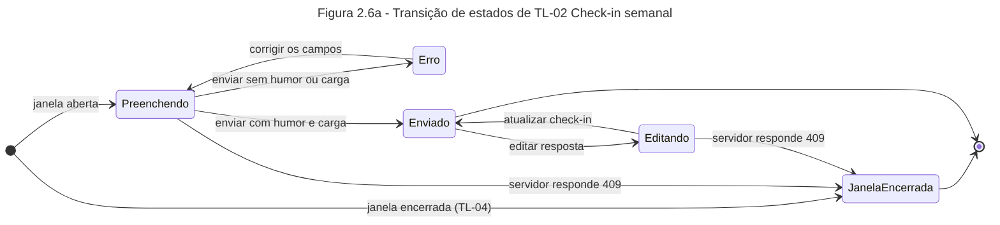
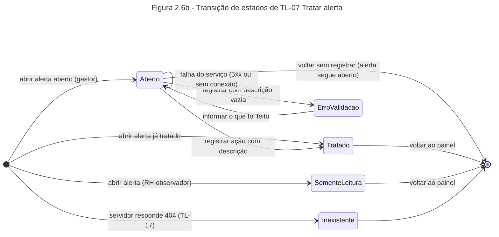

# 2.6 — Diagramas de transição de estados de TL-02 e TL-07

O Apêndice 2 do Marco 05 (regras r e s) pede diagrama de transição de estados para as telas cujo comportamento muda conforme a ação do usuário e a resposta do servidor. Esta seção traz dois: a Figura 2.6a, de TL-02 (Check-in semanal), e a Figura 2.6b, de TL-07 (Tratar alerta). Os dois usam a notação de diagrama de estados da UML, escrita em Mermaid.

## Por que só TL-02 e TL-07

As outras 15 telas não têm diagrama porque não têm ciclo de estados próprio além de "carregar e exibir" ou "enviar um formulário e mostrar o resultado":

- TL-01, TL-09, TL-11 e TL-15 têm um único envio com resultado de sucesso ou erro. Esses estados já estão na Tabela 2.5c (seção 2.5) e não formam ciclo.
- TL-03 é o mesmo comportamento de TL-02 em tela estreita, coberto pela Figura 2.6a.
- TL-04 e TL-17 são telas de destino de transições (janela encerrada e recurso inexistente), não têm transições de saída além de voltar.
- TL-05, TL-06, TL-08, TL-10, TL-12, TL-13, TL-14 e TL-16 consultam dados ou salvam um formulário sem estados intermediários que mudem a tela.

TL-02 e TL-07 são as duas telas em que o mesmo registro muda de situação (check-in enviado e editado; alerta aberto e tratado) e em que o servidor pode desviar o fluxo (409 e 404). Esta justificativa também entra nas limitações (seção 3.3).

## Figura 2.6a — Transição de estados de TL-02 Check-in semanal

Fonte: Elaborado pelos autores (2026).
Nota: fonte versionada em `docs/diagramas/2.6-estados-TL02.mmd`. Estados do protótipo cobertos: "TL-02 erro" (estado Erro) e "TL-02 enviado" (estado Enviado). TL-04 é a tela de destino quando a janela está encerrada. Uma falha do serviço (5xx ou sem conexão) não muda de estado: as respostas continuam na tela.

A Figura 2.6a mostra que o colaborador só sai de Preenchendo para Enviado com humor e carga preenchidos, e que a janela encerrada (409 do servidor) interrompe tanto o primeiro envio quanto a edição. Conferida contra a transcrição do Figma de 21/11/2026 (`docs/conferencia/figma-tl-referencia.md`): o protótipo desenha os estados "TL-02 erro" e "TL-02 enviado" e a tela TL-04, mas não desenha setas; as transições vêm da ficha do UC01 e do comportamento implementado.

## Figura 2.6b — Transição de estados de TL-07 Tratar alerta

Fonte: Elaborado pelos autores (2026).
Nota: fonte versionada em `docs/diagramas/2.6-estados-TL07.mmd`. Estado do protótipo coberto: "TL-07 tratado" (estado Tratado).

A Figura 2.6b mostra que o único erro de preenchimento de TL-07 é a descrição vazia: o tipo de ação já vem selecionado e a data de revisão é opcional, então não existe "registrar sem escolher ação". A mensagem do erro é "Informe o que foi feito.", a mesma no aviso do topo e no campo. Voltar sem registrar mantém o alerta aberto, como diz a nota do protótipo (ler o alerta não conta como tratamento). O RH vê o alerta em modo somente leitura, porque é observador (RF15, HU-13). Um alerta de outra equipe responde 404 e leva a TL-17, sem dizer que existe.

## Uso de IA

- Ferramenta: Claude, assistente de IA da Anthropic (organização responsável). A versão do modelo não foi registrada.
- URL de acesso: https://claude.ai
- Data: 23/11/2026 (criação do front-end e desta seção); 24/11/2026 (correções pedidas na revisão do PR #138).
- Uso: rascunho das transições a partir do código e do protótipo, revisado pelo autor do item.
- Prompt: "Realizaremos a criação do front-end. Valide cada item após sua criação e revalide novamente no final."
- Responsabilidade: o conteúdo foi conferido pelo autor contra o protótipo, os casos de uso e a ERS antes da entrega.
